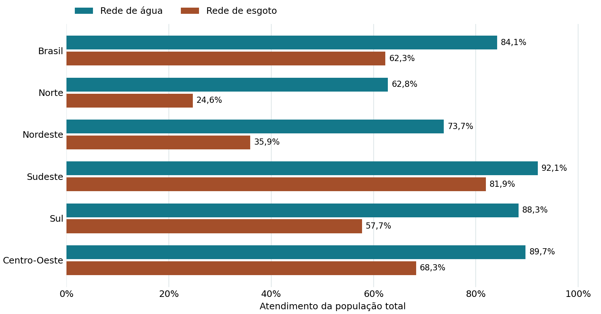
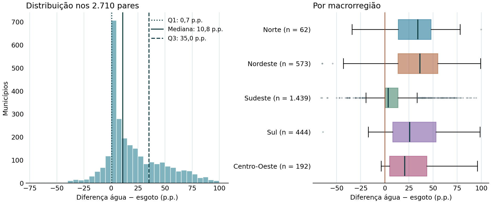

# Atendimento por redes de água e esgoto no Brasil em 2024

**Autores** — Guilherme Daflon Goulart Costa (RA 1015071) e Marcella Guimaraes Rodrigues Da Silva (RA 1015652)<br>
**Instituição** — Centro Universitário La Salle do Rio de Janeiro<br>
**Curso** — Bacharelado em Sistemas de Informação, 6º período<br>
**Disciplina** — Linguagens de Programação · 2026.2<br>
**Professor** — Alexandre Neves Louzada

[](requirements.txt)
[](requirements.txt)
[](LICENSE)
[](https://creativecommons.org/licenses/by/4.0/)
[](https://www.gov.br/cidades/pt-br/acesso-a-informacao/acoes-e-programas/saneamento/sinisa/resultados-sinisa/resultados-sinisa-2025)
[](#fair)

[Artigo no GitHub Pages](https://gdaflon.github.io/lasalle/projeto-saneamento-sinisa/) · [Notebook](notebooks/analise_exploratoria.ipynb) · [Abrir no Colab](https://colab.research.google.com/github/GDaflon/lasalle/blob/main/linguagens-de-programacao/projeto-saneamento-sinisa/notebooks/analise_exploratoria.ipynb) · [Dicionário de dados](data/data_dictionary.md)

## Resumo

O projeto compara o atendimento da população por rede de água e por rede coletora de esgoto no Brasil, com os dados abertos do SINISA 2025 (ano de referência 2024). A análise cobre três escalas: macrorregiões e UFs, áreas urbanas e rurais e municípios. Um pipeline em Python lê quatro planilhas oficiais, valida cada arquivo por hash, registra os valores não calculados sem imputá-los e cruza os municípios pelo código IBGE.

No Brasil, a rede de água atende 84,14% da população e a de esgoto, 62,30%. A diferença de 21,84 p.p. chega a 38,16 p.p. no Norte e a 62,00 p.p. no Amapá. Nenhuma UF alcança a meta legal de 99% em água, e só São Paulo e o Distrito Federal passam de 90% em esgoto. No meio rural, a coleta por rede fica abaixo de 5% em 21 UFs. Entre os 2.710 municípios com os dois indicadores válidos, a diferença mediana é de 10,82 p.p., com desvio-padrão de 26,42 p.p. e correlação de Pearson de 0,493.

**Palavras-chave** — saneamento básico, abastecimento de água, esgotamento sanitário, desigualdade territorial, SINISA, dados abertos.

## Perguntas de pesquisa e respostas

| Pergunta | Resposta curta |
| --- | --- |
| **RQ1** — Como a diferença entre os indicadores totais de água e esgoto varia entre macrorregiões e UFs? | De 10,17 p.p. (Sudeste) a 38,16 p.p. (Norte) entre regiões, e de 4,08 p.p. (SP) a 62,00 p.p. (AP) entre UFs. Em 15 UFs o esgoto atende menos de 50% da população. |
| **RQ2** — Quanto o atendimento urbano difere do rural em cada serviço? | 69,44 p.p. em água (92,32% contra 22,88%) e 63,69 p.p. em esgoto (68,44% contra 4,75%). |
| **RQ3** — Nos municípios com ambos os indicadores válidos, qual é a dispersão das diferenças e como os dois indicadores se associam? | Mediana de 10,82 p.p., quartis em 0,69 e 35,03 p.p. e 48 extremos pelo critério de Tukey. Pearson de 0,493 e Spearman de 0,541, com associação forte no Sudeste (0,676) e quase nula no Nordeste (0,149). |

<p align="center">
  
  
</p>

O [artigo](https://gdaflon.github.io/lasalle/projeto-saneamento-sinisa/) traz sete figuras, duas delas interativas: as [27 UFs com menu de ordenação](https://gdaflon.github.io/lasalle/projeto-saneamento-sinisa/assets/ufs.html) e a [dispersão dos 2.710 municípios](https://gdaflon.github.io/lasalle/projeto-saneamento-sinisa/assets/municipios.html).

## Estrutura do repositório

```
projeto-saneamento-sinisa/
├── README.md                  apresentação, resumo, reprodução e FAIR
├── LICENSE                    MIT para o código
├── requirements.txt           dependências com versões fixas (pip freeze)
├── .gitignore
├── data/
│   ├── raw/                   quatro XLSX originais do Ministério das Cidades
│   ├── processed/             municipios e territorios (CSV e Parquet) e auditoria.json
│   └── data_dictionary.md     variáveis, tipos, fórmulas e regras de tratamento
├── notebooks/
│   └── analise_exploratoria.ipynb   análise exploratória, na ordem das perguntas
├── src/
│   ├── __init__.py
│   ├── etl.py                 ingestão, validação, limpeza e cruzamento
│   └── analise.py             estatísticas e figuras
└── docs/                      artigo publicado no GitHub Pages
    ├── index.html
    └── assets/                CSS, figuras PNG e gráficos interativos
```

## Fonte e critérios

- [Ministério das Cidades — Resultados SINISA 2025](https://www.gov.br/cidades/pt-br/acesso-a-informacao/acoes-e-programas/saneamento/sinisa/resultados-sinisa/resultados-sinisa-2025). Módulos Abastecimento de Água e Esgotamento Sanitário, referência 2024.
- Os quatro XLSX originais estão em [`data/raw/`](data/raw/), incluindo a retificação da planilha municipal de água. O script valida a versão por SHA-256 e baixa os arquivos do portal se faltarem.
- A união preserva 5.149 códigos IBGE, dos quais 2.744 aparecem nos dois módulos. Os 2.710 pares válidos são usados na dispersão e nas estatísticas municipais. Marcadores de ausência ficam vazios nos dados tratados, com contagens no [registro de auditoria](data/processed/auditoria.json). Nenhum valor é imputado.
- Os percentuais consolidados vêm diretamente das planilhas oficiais. Como os módulos têm universos distintos, a diferença entre os índices descreve a distância entre taxas e não mede a parcela de pessoas atendidas por apenas um dos serviços.
- As metas de 99% e 90% até 2033 (Lei nº 11.445/2007, art. 11-B, incluído pela Lei nº 14.026/2020) servem de régua. A meta de esgoto soma coleta e tratamento, e os indicadores usados medem atendimento por rede.
- O recorte de redes deixa de fora soluções individuais, como poços e fossas. Os dados são de um único ano e os resultados municipais dependem dos registros disponíveis: a amostra pareada cobre 88,5% dos municípios do Sudeste e 15,8% dos do Norte.

## Pipeline

| Etapa | Arquivo | Entrada | Saída |
| --- | --- | --- | --- |
| Ingestão e limpeza | [`src/etl.py`](src/etl.py) | `data/raw/*.xlsx` | `data/processed/` em CSV, Parquet e JSON |
| Estatísticas e figuras | [`src/analise.py`](src/analise.py) | `data/processed/*.parquet` | cinco PNG e dois HTML interativos em `docs/assets/` |
| Exploração | [`notebooks/analise_exploratoria.ipynb`](notebooks/analise_exploratoria.ipynb) | as duas etapas acima | tabelas e gráficos comentados |
| Publicação | [`docs/index.html`](docs/index.html) | figuras e resultados | artigo no GitHub Pages |

O ETL para com erro se encontrar texto inesperado, percentual fora de 0 a 100, código IBGE duplicado ou planilha diferente da versão documentada. As regras de tratamento estão no [dicionário de dados](data/data_dictionary.md#regras-de-tratamento).

## Reprodução

Use Python 3.12. No Windows, ative o ambiente com `.venv\Scripts\activate`.

```bash
git clone https://github.com/GDaflon/lasalle.git
cd lasalle/linguagens-de-programacao/projeto-saneamento-sinisa
python3.12 -m venv .venv
source .venv/bin/activate
python -m pip install -r requirements.txt
python -m src.etl
python -m src.analise
jupyter execute notebooks/analise_exploratoria.ipynb --inplace
python -m http.server 8000 --directory docs
```

Abra [o artigo local](http://localhost:8000). O que cada comando faz:

| Comando | Resultado |
| --- | --- |
| `python -m src.etl` | Valida os XLSX e grava `municipios` e `territorios` (CSV e Parquet) e `auditoria.json` em `data/processed/`. |
| `python -m src.analise` | Imprime as estatísticas e grava as figuras e os gráficos interativos em `docs/assets/`. |
| `jupyter execute ...` | Reexecuta o notebook do início ao fim. |
| `python -m http.server ...` | Serve o artigo com os arquivos locais. |

O notebook pode rodar a partir da raiz do projeto, da pasta `notebooks/` ou no [Colab](https://colab.research.google.com/github/GDaflon/lasalle/blob/main/linguagens-de-programacao/projeto-saneamento-sinisa/notebooks/analise_exploratoria.ipynb), onde busca os scripts e as planilhas no repositório público, sem upload manual.

## FAIR

| Princípio | Onde conferir |
| --- | --- |
| Localizável (Findable) | Resumo, palavras-chave, edição e link para a fonte oficial neste README. Autoria, disciplina, semestre e instituição no cabeçalho do README, do artigo e do notebook. |
| Acessível (Accessible) | Repositório e GitHub Pages públicos. Ingestão a partir de endereço oficial, sem autenticação. Artigo responsivo, para celular e computador. |
| Interoperável (Interoperable) | [Dicionário](data/data_dictionary.md) com significado, tipo e formato de cada variável. [Dados processados](data/processed/) em CSV UTF-8 e Parquet, e auditoria em JSON. |
| Reutilizável (Reusable) | Código sob [MIT](LICENSE), texto e figuras sob CC BY 4.0. [Dependências congeladas](requirements.txt), entradas verificáveis por SHA-256 e comandos de execução acima. |

## Como citar

COSTA, G. D. G.; SILVA, M. G. R. da. **Atendimento por redes de água e esgoto no Brasil em 2024**. Rio de Janeiro: Centro Universitário La Salle do Rio de Janeiro, 2026. Projeto Prático G2 da disciplina Linguagens de Programação. Disponível em: https://gdaflon.github.io/lasalle/projeto-saneamento-sinisa/.

## Licenças e atribuição

Código próprio sob [MIT](LICENSE). Texto e figuras próprios sob [CC BY 4.0](https://creativecommons.org/licenses/by/4.0/). Os dados brutos e seus recortes mantêm a atribuição ao Ministério das Cidades (SINISA). A licença do projeto se aplica às contribuições dos autores. O JavaScript do Plotly é distribuído com seu aviso de licença incorporado.
